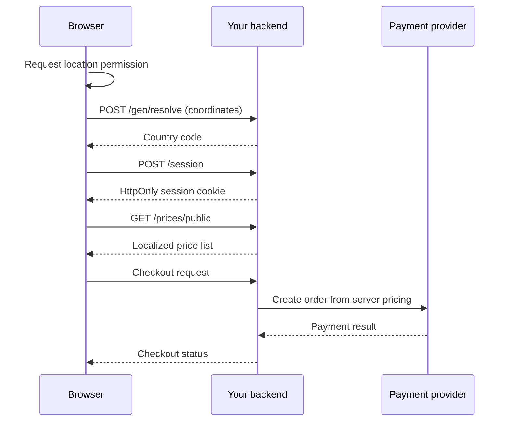

# geo-price

**Country-based regional pricing and localized checkout for the global web.**

[](https://www.npmjs.com/package/@geo-price/client)
[](https://www.npmjs.com/package/@geo-price/server)
[](https://github.com/Prabhat2912/geo-price/blob/main/LICENSE)

`geo-price` is a framework-independent TypeScript SDK for showing
country-specific prices and creating server-controlled checkout orders.
It is designed for SaaS products, subscriptions, digital products, and
online services that need:

- country pricing and regional pricing;
- geolocation-based price localization;
- explicit prices per market and currency;
- server-authoritative checkout amounts; and
- an upgrade path from detected location to verified eligibility.

The SDK does **not** derive prices from live exchange rates, silently
look up a visitor's IP address, or trust an amount supplied by the
browser.

## Packages

| Package | Use it for | Environment |
| --- | --- | --- |
| [`@geo-price/client`](https://www.npmjs.com/package/@geo-price/client) | Browser geolocation, fallback handling, pricing sessions, and cached display prices | Browser |
| [`@geo-price/server`](https://www.npmjs.com/package/@geo-price/server) | Country resolution, sessions, price lookup, checkout orders, and payment verification | Node.js |

Both packages are ESM-only and include TypeScript declarations. There
are no runtime dependencies and no required React, Express, or payment
provider integration.

## Requirements

- Node.js 18 or newer for `@geo-price/server`.
- A modern browser with `navigator.geolocation` and `fetch` for
  `@geo-price/client`.
- HTTPS in production for browser geolocation and secure cookies.
- A backend application that implements the small HTTP contract described
  below. Installing the packages does not create HTTP routes.

## Installation

Install both packages in an application that has a browser frontend and
a Node.js backend:

```bash
npm install @geo-price/client @geo-price/server
```

Install only the package you need:

```bash
# Browser-only integration
npm install @geo-price/client

# Backend-only integration
npm install @geo-price/server
```

## How it works



The browser package detects a location and requests display prices. The
backend remains authoritative: it owns the pricing configuration,
session, eligibility decision, checkout amount, and payment verification.

## Quick start

### 1. Define prices on the server

Prices are integer ISO 4217 minor units. For example, `599` means
USD 5.99, while `899` means JPY 899.

```ts
// pricing.ts
import { definePricing } from "@geo-price/server";

export const pricing = definePricing({
  premium: {
    US: { amount: 599, currency: "USD" },     // $5.99
    GB: { amount: 479, currency: "GBP" },     // £4.79
    IN: { amount: 17979, currency: "INR" },   // ₹179.79
    JP: { amount: 899, currency: "JPY" },     // ¥899
  },
});
```

Use explicit per-country prices for production. The values above are
examples only and are not pricing recommendations.

### 2. Implement the backend contract

Set `apiUrl` in the browser client to the origin that exposes these
routes:

| Method and path | Request | Response | Purpose |
| --- | --- | --- | --- |
| `POST /geo/resolve` | `{ latitude, longitude }` | `{ countryCode: "IN" }` | Resolve coordinates to a country |
| `POST /session` | `{ countryCode, evidence: "detected" }` | `{ sessionId }` plus `Set-Cookie` | Create the pricing session |
| `GET /prices/public?countryCode=IN` | Query string | `{ premium: { amount, currency } }` | Return display prices |

`@geo-price/server` exports the helpers needed to implement these
routes. A minimal route outline looks like this:

```ts
import {
  createPricingSession,
  lookupPrice,
  MemorySessionStore,
  resolveCountryByCoordinates,
  sessionCookie,
} from "@geo-price/server";
import { pricing } from "./pricing.js";

const store = new MemorySessionStore();

// POST /geo/resolve
const resolved = resolveCountryByCoordinates(
  request.body.latitude,
  request.body.longitude,
);
if (!resolved) {
  return response.status(422).json({ error: "Country not resolved" });
}
response.json({ countryCode: resolved.code });

// POST /session
const session = await createPricingSession(
  {
    countryCode: request.body.countryCode,
    evidence: "detected",
    ttlMs: 24 * 60 * 60 * 1000,
  },
  store,
);
response.setHeader("Set-Cookie", sessionCookie(session));
response.json({ sessionId: session.sessionId });

// GET /prices/public?countryCode=IN
const countryCode = String(request.query.countryCode ?? "").toUpperCase();
const prices = Object.fromEntries(
  Object.keys(pricing).flatMap((productId) => {
    const price = lookupPrice(pricing, productId, countryCode);
    return price
      ? [[productId, { amount: price.amount, currency: price.currencyCode }]]
      : [];
  }),
);
response.json(prices);
```

The example uses generic `request` and `response` objects so it can be
adapted to Express, Fastify, Hono, a serverless function, or another
HTTP framework. Validate request bodies and query parameters in your
application before calling the helpers.

### 3. Initialize the browser client

```ts
import { initGeoPrice } from "@geo-price/client";

const geoPrice = await initGeoPrice({
  apiUrl: "https://api.example.com",
  detection: "browser-geolocation",
  fallback: {
    mode: "default-country",
    countryCode: "US",
  },
});
```

Initialization waits for detection, session setup, and the initial
public price list. It can reject if the backend is unavailable or a
configured fallback request fails.

### 4. Display a localized price

```ts
const price = await geoPrice.getPrice("premium");

if (price) {
  priceElement.textContent = `${price.major} ${price.currencyCode}`;
} else {
  priceElement.textContent = "Price unavailable";
}
```

`getPrice()` reads the cache created during initialization. It does not
make a checkout request or allow the browser to choose an amount.

### 5. Create checkout on the server

Use the session cookie and server-side configuration to create an order:

```ts
import { createPaymentOrder } from "@geo-price/server";

const order = await createPaymentOrder({
  request: { cookies: request.cookies },
  productId: "premium",
  config: pricing,
  store,
  provider,
  requireEvidence: "verified",
});

if (!order) {
  return response.status(403).json({
    error: "The visitor is not eligible for checkout",
  });
}

// Persist order.orderId, order.amount, order.currency, and the user
// before redirecting to the payment provider.
response.json(order);
```

The SDK does not persist orders or provide a payment-provider adapter.
Your application must persist the order, create the provider checkout,
verify the provider response, and grant access only after verification.

## Fallback policies

A fallback is required because location permission can be denied,
unavailable, or inaccurate.

| Mode | Behavior |
| --- | --- |
| `default-country` | Uses a configured country, creates a detected session, and fetches its prices. |
| `default-price` | Uses local per-product prices and does not create a session. |
| `require-verification` | Does not expose a country or price until your application establishes a verified session. |
| `browse-only` | Does not expose a country or price; your application decides how checkout is gated. |

```ts
fallback: { mode: "default-country", countryCode: "US" }

fallback: {
  mode: "default-price",
  prices: { premium: { amount: 599, currency: "USD" } },
}

fallback: { mode: "require-verification" }
fallback: { mode: "browse-only" }
```

`require-verification` and `browse-only` behave the same inside the
client. The distinction is how your application handles verification and
checkout.

## Security and trust model

Browser geolocation is a location signal, not proof of residency.

- Treat `detected` evidence as unverified.
- Assign `verified` evidence only on the backend after an independent
  check, such as billing-country or payment-provider verification.
- Never accept `evidence: "verified"` from a browser request.
- Never accept amount or currency from the browser as checkout authority.
- Use `requireEvidence: "verified"` for price-sensitive products.
- Persist the order's amount and currency and compare both with the
  payment provider's verified response.
- Use `HttpOnly`, `Secure`, and an appropriate `SameSite` policy for the
  session cookie.
- When using credentials cross-origin, allow only the exact frontend
  origin; do not use a wildcard CORS origin.
- Avoid retaining raw coordinates longer than necessary.
- Use a shared `SessionStore` such as Redis or a database for
  serverless and multi-instance deployments.

The SDK does not prevent a determined user from submitting another
country code. If eligibility has financial or regulatory consequences,
implement independent verification and enforce it on the server.

## Country resolution

`@geo-price/server` includes a local coordinate-to-country resolver
backed by Natural Earth 1:50m country polygons. It requires no API key
and makes no network calls.

The dataset uses simplified borders, so tiny territories and points near
coastlines may not resolve precisely. A result can include a non-zero
distance from the nearest border. Apply a distance limit or an
independent verification flow where country eligibility matters.

## Regional price derivation

For bootstrapping, `defineRegionalPricing` can derive a complete table
from a base price and local-price multipliers:

```ts
import { defineRegionalPricing } from "@geo-price/server";

const pricing = defineRegionalPricing({
  premium: { amount: 599, currency: "USD" },
});
```

These multipliers are illustrative local-price ratios, **not live
exchange rates** and not validated purchasing-power recommendations.
Review every generated price before showing it to customers or use
explicit per-country prices in production.

## Client API

The client exposes:

```ts
interface GeoPriceClient {
  getCountryCode(): Promise<string | null>;
  getEvidenceLevel(): Promise<"detected" | "verified" | null>;
  getPrice(productId: string): Promise<Price | null>;
  getPrices(): Promise<Record<string, Price | null>>;
  refresh(): Promise<void>;
  destroy(): void;
}
```

`Price` includes `productId`, `countryCode`, `currencyCode`, `amount`,
and the formatted `major` value. See the
[`@geo-price/client` README](./packages/client/README.md) for fallback
configuration, cookies, CORS, and custom country resolvers.

## Server API

The server package exports helpers for:

- pricing definitions and regional price derivation;
- pricing sessions and cookie serialization;
- session-based price calculation;
- payment-order creation and payment verification;
- coordinate-to-country resolution;
- currency metadata and minor-unit conversion; and
- development-only in-memory sessions.

See the [`@geo-price/server` README](./packages/server/README.md) for
complete API examples and integration details.

## Development

Clone the repository and install dependencies:

```bash
git clone https://github.com/Prabhat2912/geo-price.git
cd geo-price
npm install
```

Build both packages:

```bash
npm run build
```

Run the repository checks:

```bash
npm run check
```

The checks cover country resolution, regional pricing, sessions, and
checkout behavior. The package build outputs are written to each
package's `dist/` directory and are excluded from the published source
repository workflow.

## Contributing

Issues and pull requests are welcome in the
[GitHub repository](https://github.com/Prabhat2912/geo-price). Please
include a focused description, reproduction steps for bugs, and tests
for behavior changes where practical.

## License

ISC
